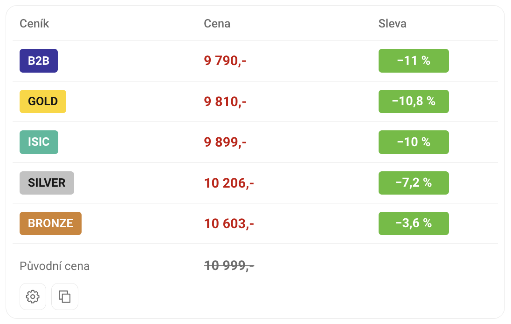

# Alza Benefit Prices

 <strong>Čeština</strong> · <a href="README/README.sk.md"> Slovenčina</a> · <a href="README/README.en.md"> English</a> · <a href="README/README.hu.md"> Magyar</a> · <a href="README/README.de.md"> Deutsch</a>

Zobrazí ceny ceníků **Gold, Silver, ISIC, Bronze, B2B a Basic** přímo u produktu na Alze, včetně slev a akčních nabídek.

Funguje na **Alza.cz, Alza.sk, Alza.hu, Alza.de a Alza.at**, na počítači i mobilu.

## 📸 Ukázka

## ⚙️ Instalace

[Nainstalovat Alza Benefit Prices](https://raw.githubusercontent.com/dexnis-dev/Alza-Benefit-Prices/main/alza-benefit-prices.user.js)

### Chrome, Edge, Firefox a další prohlížeče

1. Nainstaluj **Violentmonkey**: [Chrome a další Chromium](https://chromewebstore.google.com/detail/violentmonkey/jinjaccalgkegednnccohejagnlnfdag) · [Edge](https://microsoftedge.microsoft.com/addons/detail/violentmonkey/eeagobfjdenkkddmbclomhiblgggliao) · [Firefox](https://addons.mozilla.org/firefox/addon/violentmonkey/).
2. Pokud to prohlížeč vyžaduje, v nastavení rozšíření Violentmonkey zapni **Povolit uživatelské skripty**.
3. Klikni na instalační odkaz výše a potvrď instalaci ve Violentmonkey.
4. Otevři nebo obnov stránku produktu na Alze.

### Safari

1. Nainstaluj [Userscripts z App Store](https://apps.apple.com/app/userscripts/id1463298887) a zapni ho v nastavení Safari.
2. Povol přístup k Alze a `webapi.alza.cz`.
3. Otevři instalační odkaz výše a potvrď přidání přes ikonu Userscripts. Potom obnov stránku produktu.

Pokud se instalace nenabídne, vlož obsah skriptu ručně do editoru Userscripts.

## 🔧 Používání

Ceny se zobrazí automaticky. V **nastavení** si můžeš:

- Vybrat ceníky a akce, které chceš zobrazovat.
- Zapnout zobrazení i bez slevy.
- Na počítači přesunout panel pod fotky produktu.
- Přidat své affiliate číslo do kopírovaného odkazu.

Nastavení se ukládá automaticky.

## 📋 Kopírování nabídky

Tlačítko pro kopírování zkopíruje název produktu, ceny a odkaz pro sdílení do chatu nebo e-mailu.

**Kopírování používá všechny ceníky a akce, i ty vypnuté v panelu.** Stejné nabídky spojí, různé akce rozdělí. Když není sleva, zkopíruje běžnou cenu.

## 📄 Licence

Tento projekt je otevřený pod licencí MIT.
