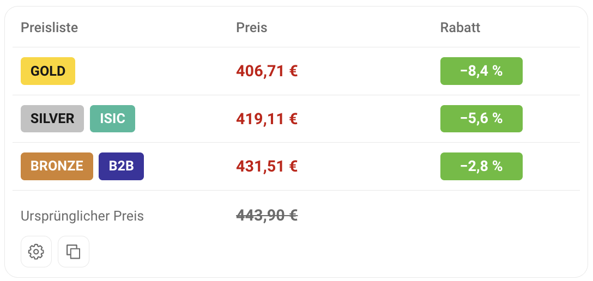

# Alza Benefit Prices

<a href="../README.md"> Čeština</a> · <a href="README.sk.md"> Slovenčina</a> · <a href="README.en.md"> English</a> · <a href="README.hu.md"> Magyar</a> ·  <strong>Deutsch</strong>

Zeigt die Preise von **Gold, Silver, ISIC, Bronze, B2B und Basic** direkt auf Alza-Produktseiten an, einschließlich Rabatten und Aktionsangeboten.

Funktioniert auf **Alza.cz, Alza.sk, Alza.hu, Alza.de und Alza.at**, am Computer und auf dem Handy.

## 📸 Vorschau

## ⚙️ Installation

[Alza Benefit Prices installieren](https://raw.githubusercontent.com/dexnis-dev/Alza-Benefit-Prices/main/alza-benefit-prices.user.js)

### Chrome, Edge, Firefox und andere Browser

1. Installiere **Violentmonkey**: [Chrome und andere Chromium-Browser](https://chromewebstore.google.com/detail/violentmonkey/jinjaccalgkegednnccohejagnlnfdag) · [Edge](https://microsoftedge.microsoft.com/addons/detail/violentmonkey/eeagobfjdenkkddmbclomhiblgggliao) · [Firefox](https://addons.mozilla.org/firefox/addon/violentmonkey/).
2. Falls dein Browser es verlangt, aktiviere **Benutzerskripte zulassen** in den Einstellungen der Violentmonkey-Erweiterung.
3. Klicke auf den Installationslink oben und bestätige die Installation in Violentmonkey.
4. Öffne eine Produktseite auf Alza oder lade sie neu.

### Safari

1. Installiere [Userscripts aus dem App Store](https://apps.apple.com/app/userscripts/id1463298887) und aktiviere es in Safari.
2. Erlaube den Zugriff auf Alza und `webapi.alza.cz`.
3. Öffne den Installationslink oben und bestätige über das Userscripts-Symbol. Lade dann die Produktseite neu.

Wird keine Installation angeboten, füge den Skriptinhalt manuell im Userscripts-Editor ein.

## 🔧 Verwendung

Die Preise erscheinen automatisch. In den **Einstellungen** kannst du:

- Die angezeigten Preislisten und Aktionen auswählen.
- Preise auch ohne Rabatt anzeigen.
- Das Panel am Computer unter die Produktfotos verschieben.
- Deine Affiliate-Nummer zum kopierten Link hinzufügen.

Einstellungen werden automatisch gespeichert.

## 📋 Angebot kopieren

Die Kopierschaltfläche kopiert Produktname, Preise und Link zum Teilen in einem Chat oder einer E-Mail.

**Beim Kopieren werden alle Preislisten und Aktionen berücksichtigt, auch die im Panel deaktivierten.** Gleiche Angebote werden zusammengefasst, unterschiedliche Aktionen getrennt. Ohne Rabatt wird der reguläre Preis kopiert.

## 📄 Lizenz

Dieses Projekt steht unter der MIT-Lizenz.
