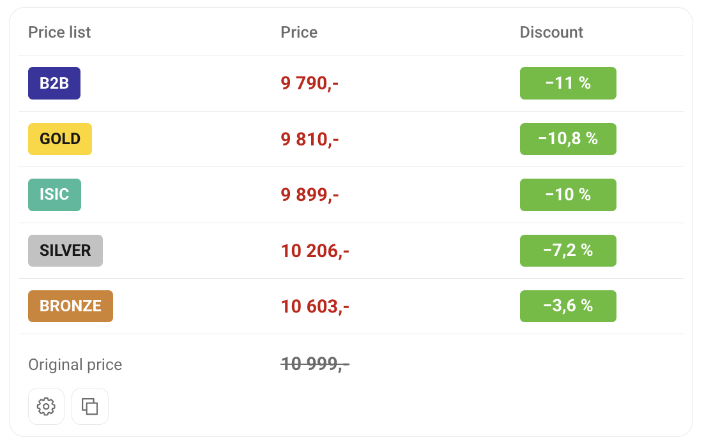

# Alza Benefit Prices

<a href="../README.md"> Čeština</a> · <a href="README.sk.md"> Slovenčina</a> ·  <strong>English</strong> · <a href="README.hu.md"> Magyar</a> · <a href="README.de.md"> Deutsch</a>

Shows **Gold, Silver, ISIC, Bronze, B2B and Basic** prices directly on Alza product pages, including discounts and special offers.

Works on **Alza.cz, Alza.sk, Alza.hu, Alza.de and Alza.at**, on desktop and mobile.

## 📸 Preview

## ⚙️ Installation

[Install Alza Benefit Prices](https://raw.githubusercontent.com/dexnis-dev/Alza-Benefit-Prices/main/alza-benefit-prices.user.js)

### Chrome, Edge, Firefox and other browsers

1. Install **Violentmonkey**: [Chrome and other Chromium browsers](https://chromewebstore.google.com/detail/violentmonkey/jinjaccalgkegednnccohejagnlnfdag) · [Edge](https://microsoftedge.microsoft.com/addons/detail/violentmonkey/eeagobfjdenkkddmbclomhiblgggliao) · [Firefox](https://addons.mozilla.org/firefox/addon/violentmonkey/).
2. If your browser requires it, enable **Allow user scripts** in the Violentmonkey extension settings.
3. Click the installation link above and confirm the installation in Violentmonkey.
4. Open or reload a product page on Alza.

### Safari

1. Install [Userscripts from the App Store](https://apps.apple.com/app/userscripts/id1463298887) and enable it in Safari settings.
2. Allow access to Alza and `webapi.alza.cz`.
3. Open the installation link above and confirm through the Userscripts icon. Then reload the product page.

If installation is not offered, paste the script into the Userscripts editor manually.

## 🔧 Usage

Prices appear automatically. In **settings**, you can:

- Choose which price lists and promotions to display.
- Show prices even without discounts.
- Move the panel below product photos on desktop.
- Add your affiliate number to copied links.

Settings are saved automatically.

## 📋 Copy an offer

The copy button copies the product name, prices and link for sharing in a chat or email.

**Copying uses all price lists and promotions, including those disabled in the panel.** Matching offers are merged, while different promotions are kept separate. Without a discount, it copies the regular price.

## 📄 License

This project is released under the MIT License.
