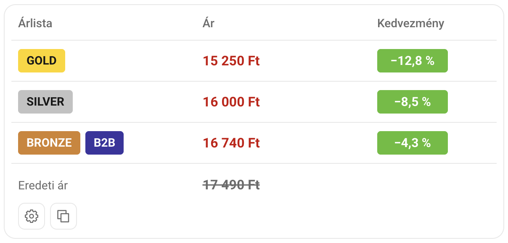

# Alza Benefit Prices

<a href="../README.md"> Čeština</a> · <a href="README.sk.md"> Slovenčina</a> · <a href="README.en.md"> English</a> ·  <strong>Magyar</strong> · <a href="README.de.md"> Deutsch</a>

Megjeleníti a **Gold, Silver, ISIC, Bronze, B2B és Basic** árlisták árait közvetlenül az Alza termékoldalain, kedvezményekkel és akciókkal együtt.

Az **Alza.cz, Alza.sk, Alza.hu, Alza.de és Alza.at** oldalakon működik, számítógépen és mobilon is.

## 📸 Előnézet

## ⚙️ Telepítés

[Alza Benefit Prices telepítése](https://raw.githubusercontent.com/dexnis-dev/Alza-Benefit-Prices/main/alza-benefit-prices.user.js)

### Chrome, Edge, Firefox és más böngészők

1. Telepítsd a **Violentmonkey** bővítményt: [Chrome és más Chromium-böngészők](https://chromewebstore.google.com/detail/violentmonkey/jinjaccalgkegednnccohejagnlnfdag) · [Edge](https://microsoftedge.microsoft.com/addons/detail/violentmonkey/eeagobfjdenkkddmbclomhiblgggliao) · [Firefox](https://addons.mozilla.org/firefox/addon/violentmonkey/).
2. Ha a böngésző megköveteli, engedélyezd a **felhasználói szkripteket** a Violentmonkey bővítmény beállításaiban.
3. Kattints a fenti telepítési hivatkozásra, és erősítsd meg a telepítést a Violentmonkey-ben.
4. Nyiss meg vagy frissíts egy termékoldalt az Alzán.

### Safari

1. Telepítsd a [Userscripts alkalmazást az App Store-ból](https://apps.apple.com/app/userscripts/id1463298887), és kapcsold be a Safari beállításaiban.
2. Engedélyezd a hozzáférést az Alzához és a `webapi.alza.cz` címhez.
3. Nyisd meg a fenti telepítési hivatkozást, és erősítsd meg a Userscripts ikonján keresztül. Ezután frissítsd a termékoldalt.

Ha a telepítés nem jelenik meg, illeszd be kézzel a szkriptet a Userscripts szerkesztőjébe.

## 🔧 Használat

Az árak automatikusan megjelennek. A **beállításokban**:

- Kiválaszthatod a megjelenített árlistákat és akciókat.
- Kedvezmény nélkül is megjelenítheted az árakat.
- Számítógépen a termékfotók alá helyezheted a panelt.
- Hozzáadhatod affiliate partnerszámodat a másolt hivatkozáshoz.

A beállítások automatikusan mentődnek.

## 📋 Ajánlat másolása

A másolás gomb a termék nevét, árait és hivatkozását másolja chatben vagy e-mailben történő megosztáshoz.

**A másolás minden árlistát és akciót figyelembe vesz, a panelen kikapcsoltakat is.** Az azonos ajánlatokat összevonja, az eltérő akciókat külön tartja. Kedvezmény nélkül a normál árat másolja.

## 📄 Licenc

Ez a projekt MIT licenc alatt érhető el.
