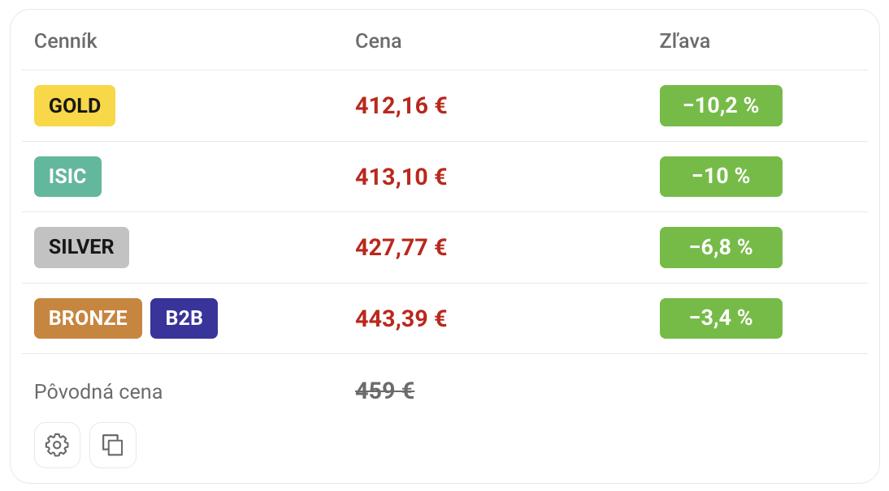

# Alza Benefit Prices

<a href="../README.md"> Čeština</a> ·  <strong>Slovenčina</strong> · <a href="README.en.md"> English</a> · <a href="README.hu.md"> Magyar</a> · <a href="README.de.md"> Deutsch</a>

Zobrazí ceny cenníkov **Gold, Silver, ISIC, Bronze, B2B a Basic** priamo pri produkte na Alze, vrátane zliav a akčných ponúk.

Funguje na **Alza.cz, Alza.sk, Alza.hu, Alza.de a Alza.at**, na počítači aj mobile.

## 📸 Ukážka

## ⚙️ Inštalácia

[Nainštalovať Alza Benefit Prices](https://raw.githubusercontent.com/dexnis-dev/Alza-Benefit-Prices/main/alza-benefit-prices.user.js)

### Chrome, Edge, Firefox a ďalšie prehliadače

1. Nainštaluj **Violentmonkey**: [Chrome a ďalšie Chromium prehliadače](https://chromewebstore.google.com/detail/violentmonkey/jinjaccalgkegednnccohejagnlnfdag) · [Edge](https://microsoftedge.microsoft.com/addons/detail/violentmonkey/eeagobfjdenkkddmbclomhiblgggliao) · [Firefox](https://addons.mozilla.org/firefox/addon/violentmonkey/).
2. Ak to prehliadač vyžaduje, v nastaveniach rozšírenia Violentmonkey zapni **Povoliť používateľské skripty**.
3. Klikni na inštalačný odkaz vyššie a potvrď inštaláciu vo Violentmonkey.
4. Otvor alebo obnov stránku produktu na Alze.

### Safari

1. Nainštaluj [Userscripts z App Store](https://apps.apple.com/app/userscripts/id1463298887) a zapni ho v nastaveniach Safari.
2. Povoľ prístup k Alze a `webapi.alza.cz`.
3. Otvor inštalačný odkaz vyššie a potvrď pridanie cez ikonu Userscripts. Potom obnov stránku produktu.

Ak sa inštalácia neponúkne, vlož obsah skriptu ručne do editora Userscripts.

## 🔧 Používanie

Ceny sa zobrazia automaticky. V **nastaveniach** si môžeš:

- Vybrať zobrazované cenníky a akcie.
- Zapnúť zobrazenie aj bez zľavy.
- Na počítači presunúť panel pod fotky produktu.
- Pridať svoje affiliate číslo do kopírovaného odkazu.

Nastavenia sa ukladajú automaticky.

## 📋 Kopírovanie ponuky

Tlačidlo na kopírovanie skopíruje názov produktu, ceny a odkaz na zdieľanie do chatu alebo e-mailu.

**Kopírovanie používa všetky cenníky a akcie, aj tie vypnuté v paneli.** Rovnaké ponuky spojí, rôzne akcie rozdelí. Ak nie je zľava, skopíruje bežnú cenu.

## 📄 Licencia

Tento projekt je dostupný pod licenciou MIT.
